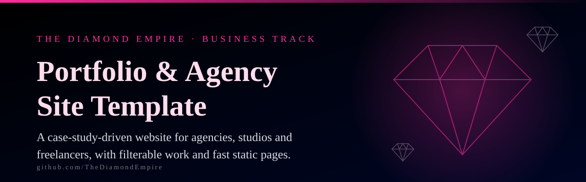
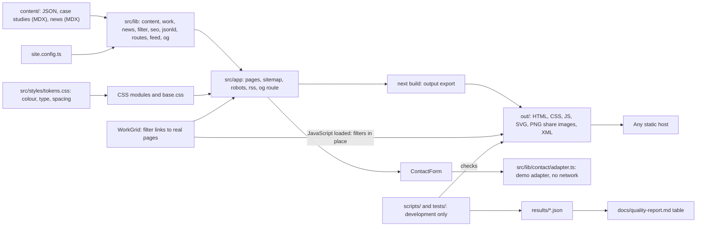

<p align="center"></p>

<p align="center">
  
  
  
</p>

# Portfolio & Agency Site Template

> A case-study-driven website for agencies, studios and freelancers, with filterable work and fast static pages.

A Next.js template for agencies, studios and freelancers whose work is the product: a filterable work grid, long-form case-study pages, services, team and contact, all statically generated, accessible and easy to rebrand.

**Quick links:** [Architecture](#architecture) · [Tech stack](#tech-stack) · [Engineering decisions](#engineering-decisions) · [Quality report](docs/quality-report.md) · [Roadmap](#roadmap) · [Case study](docs/case-study.md)

> **Public showcase.** This repository holds the documentation, client case study, research report and measured results for this product. The runnable source code is distributed separately under a license: see [SOURCE-ACCESS.md](SOURCE-ACCESS.md).

## At a glance

|  |  |
|---|---|
| **Track** | Business · Advanced |
| **Phase** | Beta: all five milestones work, the tests pass from a clean short-path copy, and [docs/quality-report.md](docs/quality-report.md) records the results. Not Live: no customer has used it, no real form provider has been connected and the sample content is invented. |
| **Primary reader** | Clients and founders |
| **Read next** | [Quality report](docs/quality-report.md) · [Client case study](docs/case-study.md) |

## Why this exists

Creative professionals lose clients to slow, generic portfolio sites. Showing work well needs good case-study layouts, filtering and image handling, which most templates do poorly.

## What it does (built and tested)

- **Pages (20 exported documents):** home, work, three category pages, six case studies, services, team, news with four posts, contact and a 404 page. All content is sample content for a made-up studio, "The Diamond Empire Studio": its clients, results, people and quotes are invented.
- **Work grid whose filter works without JavaScript:** the filter links are ordinary links to real pages (`/work/` and `/work/category/<id>/`), and each page is delivered with the right projects showing. When the page's JavaScript has loaded, a click or the Enter key filters in place, announces the count, updates the address and the title, leaves a click with a modifier key alone and follows Back and Forward. Tested both ways in a real Chrome.
- **Case studies from MDX:** typed front matter validated when the site is built (a malformed file stops the build and names the file and the field), a cover, figures and galleries, pull quotes, a results block, and previous and next project links that wrap around.
- **Pictures that cannot shift the layout:** every picture is written by one component that always sets `width`, `height` and `alt`, loads lazily except the first, and supports `srcset` when you supply smaller variants. The export checks fail when a picture has no size, no alt text, no file or an SVG whose own size differs from the stated one. The sample pictures are generated SVG artwork: no photographs, no stock images.
- **A share image for every page:** one 1200 x 630 PNG per indexable page, drawn at build time (see [Share images](#share-images-and-their-licence)).
- **Services, team, contact and news:** a services page with process and questions (native `details`), a team page with drawn stand-ins for portraits, a contact form with validation and an honest demo adapter (no network request, a confirmation that says "Demo"), news posts in MDX and an RSS feed of them.
- **Static export:** Next.js App Router with `output: 'export'` and `trailingSlash`, so every page is a folder with an `index.html` that any static host serves. No server is needed.
- **Design tokens and one config file:** colours, type scale, spacing and shape live in `src/styles/tokens.css`; names, address, contact details and navigation live in `site.config.ts`. A test fails if a hex colour, a font file or an external reference appears anywhere else in the styles, or if a stylesheet uses a token that does not exist.
- **Light and dark themes** from the same tokens: automatic through `prefers-color-scheme`, plus a toggle that remembers the choice on the device (local storage, no cookie). The dark values are written twice (media query and toggle) and a test fails if the copies differ.
- **SEO:** per-page title, description and canonical link from a configurable site address (`siteUrl` or `SITE_URL`), Open Graph and Twitter tags that name each page's own share image, `sitemap.xml`, `robots.txt`, JSON-LD for Organization, CreativeWork, BlogPosting and BreadcrumbList. Scripts check that the sitemap, the feed and every canonical link agree with the exported pages.
- **Accessibility work that is tested:** landmarks, a skip link, keyboard operation with a visible focus ring, focus moved to the main area after a page change (and deliberately not when the filter changes the address), reduced motion respected, colour contrast computed from the tokens in both themes. Automated tools find only part of the problems that affect people, so this is **not** a claim of conformance with any accessibility standard; see the [quality report](docs/quality-report.md) for what was tested and what was not.
- **No tracking:** no analytics, no third-party requests, no web fonts, no CDN; system font stacks only.
- **Budgets enforced by tests:** page weight, gzip size, JavaScript size and request count per page, a layout-shift budget, zero third-party requests, valid HTML, every link and anchor resolving.
- **Customer package:** `npm run package` builds a ZIP of the template source with its own `package.json`, guides and `START-HERE.md`; the measurement run extracts it, installs it, type-checks, lints, tests and builds it.

## Architecture



## Tech stack

| Layer | Technology used |
|---|---|
| Framework | Next.js 16.4.4 (App Router, static export, Turbopack build), React 19.3.1, TypeScript 5.9.3 |
| Styling | CSS custom properties and CSS modules; no runtime CSS-in-JS, no Tailwind |
| Content | JSON files and MDX (case studies and news, compiled at build time with `@mdx-js/mdx` 3.1.1 and `remark-gfm` 4.0.1; front matter read with `yaml` 2.9.1) |
| Artwork, pictures and type | Generated SVG artwork written by a script; inline SVG; system font stacks; share images drawn at build time by the image feature that comes with Next.js |
| Unit tests | Vitest 5.1.0, Testing Library, jsdom 30.1.3 |
| Lint and types | ESLint 9.39.5 with `eslint-config-next` (including accessibility rules for markup), `tsc` |
| Export checks | `html-validate` 11.18.0; `axe-core` 4.14.0 in the installed Chrome driven by `playwright-core` 1.64.1; scripts for contrast, links, metadata, sitemap and feed, pictures, share images, layout shift, the work filter, weight, third parties |
| Packaging | `adm-zip` 0.6.1 builds a deterministic ZIP |
| Delivery | Static files; a GitHub Actions workflow that runs the same commands (it has never been run, see below) |

## Engineering decisions

### Filtering without JavaScript first

The filter is a list of real links to real pages, enhanced when the script has loaded. The enhancement is the second way in, never the only one: it is tested with scripts switched off (each category page must show only its projects) and with scripts on. A real defect was found this way: the "move focus to the main area after a page change" behaviour also fired when the filter changed the address, so a keyboard user lost their place in the filter. It is fixed and covered by a unit test and a browser test (see the change log in the quality report).

### Content is data

Case studies and news posts are files with typed front matter validated when the site is built, so a malformed entry stops the build with a message that names the file and the field instead of reaching the live site. Unit tests show that each rule can fail.

### Images cannot shift the layout

Every picture carries its width and height, and the stylesheet makes it `height: auto`, so the browser reserves the picture's shape before the file arrives. Layout shift is measured in Chrome on every page at two widths against a budget set before measuring, and a control page (a picture with no size) proves that the measurement can see a shift.

### Links without prefetching

Internal links use the Next.js `Link` component with `prefetch={false}`, so loading a page requests exactly the files named in its HTML. A test fails if a link is added without it. Navigation still works client-side; focus moves to the main area after each change.

### No hamburger menu

The main navigation wraps onto a second line on narrow screens instead of hiding behind a button. It works without JavaScript, has no state to get wrong and was scanned at 320 px wide.

### Tokens, with the dark values written twice

CSS cannot share one block between `@media (prefers-color-scheme: dark)` and `[data-theme="dark"]`, so the dark values appear twice; a test fails if they differ. Every colour is a plain hex token so contrast can be computed from it.

### Honest forms

The default adapter is a stand-in that says so on screen. It cannot be mistaken for a working form.

### Accessibility is tested, not promised

Every exported page is scanned with axe-core in Chrome at 320, 768 and 1280 px in both themes (plus the filtered work page and the contact form's error and confirmation states), and keyboard and landmark behaviour are covered by scripted tests. These tests find only part of the problems that affect people; what they cannot cover is listed in the quality report.

### Rebranding is configuration

Brand values live in `src/styles/tokens.css` and `site.config.ts`; the guides show the few lines to change.

## Share images and their licence

The share images are drawn at build time by `ImageResponse`, the image feature that is compiled inside the `next` package (`@vercel/og`, whose licence field is MPL-2.0, with the Geist Regular font under the SIL Open Font Licence). It runs only while building; no code, font or WebAssembly file from it is in the exported site (a test checks the exported files), and it does not appear in this repository's licence check, which reads the lockfile. See `THIRD-PARTY.md`.

## Quality bar

Enforced by the commands in [Verification](#verification) and recorded in the [quality report](docs/quality-report.md):

- Clean install, type check, lint, unit tests and static build pass from a clean short-path copy
- html-validate on every exported page (recommended preset; five rules adjusted for framework output, disclosed in the report)
- An axe-core scan of every exported page in the tested variants, with violations and "needs review" items counted (partial coverage, stated plainly)
- Per-page weight, gzip, JavaScript and request budgets, a layout-shift budget, and no third-party requests
- Every internal link and anchor resolves; every page has a title, description, one h1 and (except the 404 page) a canonical URL and its own share image
- Case-study front matter is validated when the site is built; missing pictures, missing picture sizes and broken links fail the tests

## Not built yet / out of scope

- **A real form provider connection.** The adapter ships as a stand-in on purpose; examples are documented, none was tested against a live service.
- **Photography and an image pipeline.** The template uses generated SVG artwork; it does not resize or convert pictures (that needs a server or a build step). It supports `srcset` from variants you supply. The sample pictures are not photographs, so real pictures will weigh more.
- **A lightbox or full-screen gallery.** Galleries are a grid of figures with captions.
- **Pagination, search, comments and a CMS.** Out of scope for a portfolio template; news has no tag pages.
- **Screen reader, Firefox, Safari and real-device testing.** Only the installed Chrome was used.
- **Serving from a sub-folder** (`example.org/site/`). Use a domain or sub-domain.
- **Multiple languages and right-to-left layouts.**
- **Client results.** `docs/case-study.md` keeps its Results table blank: it is for measured engagements and none has happened. The results shown on the sample case studies are invented and labelled as such.
- **The GitHub Actions workflow has not been run.** It runs the same commands as local development, but this repository was built and verified locally only.
- **Performance timings and Lighthouse runs.** Not measured: the machine was shared and loaded.

## Roadmap

- [x] M1: skeleton, tokens, layout and navigation
- [x] M2: work grid with no-JavaScript filtering and enhancement
- [x] M3: MDX case-study pages and galleries
- [x] M4: services, team, contact, RSS, sitemap and OG images
- [x] M5: accessibility, budget and content-validation tests; docs

## Getting started

> _These instructions refer to the source package, which is distributed separately and is not part of this showcase repository._

Requirements: Node 22 or later and Google Chrome or Microsoft Edge installed (the export checks drive the installed browser; nothing is downloaded). On Windows keep the project in a short folder path, because deep paths can break the tooling. From a clean checkout:

```text
npm ci
npm run check
npm run build
npm run serve
```

`npm run check` runs the type check, the lint and the unit and static tests. `npm run build` writes the site to `out/`; `npm run serve` shows it at http://127.0.0.1:3000. `npm run dev` starts the development server. To check the export in a browser and run the measurements:

```text
npm run test:export
npm run measure
npm run package
```

`npm run package` writes `dist/portfolio-agency-template-0.1.0.zip` for customers. The customer guides are in `docs/guide/` and are part of the ZIP. `npm run make:art` rewrites the sample SVG pictures (the same bytes every time).

## Verification

> _These instructions refer to the source package, which is distributed separately and is not part of this showcase repository._

| Command | What it checks |
|---|---|
| `npm run typecheck` and `npm run lint` | TypeScript and ESLint (Next.js, React hooks and accessibility rules) |
| `npm test` | unit tests (components, the work grid and its filter logic, case-study and news validation, pictures, feed and sitemap logic, the contact form) and static tests (tokens and contrast from tokens, source rules, licences and notices, ZIP contents, documents) |
| `npm run test:export` | builds the site, then html-validate, links, metadata and structured data, sitemap, robots and feed consistency, pictures, share images, weight budgets, third-party and tracking scans, and a real Chrome: page structure, requests, the work filter with and without JavaScript, form behaviour, keyboard, theme, reduced motion, layout shift, axe-core matrix |
| `npm run measure` | builds and runs every measurement once in one invocation, writes raw output to `results/` |
| `npm run report:table` | regenerates the results table in `docs/quality-report.md` from `results/` |
| `npm run test:record` | runs the whole suite once and records the counts in `results/test-run.json` |
| `npm run contrast`, `npm run licenses`, `npm run check:paths` | single checks on their own |

The final verification was run from a clean copy at a short path (`npm ci`, then the commands above) with its outputs written outside the copy; see the [quality report](docs/quality-report.md) for results and limits.

## Repository layout

> _These instructions refer to the source package, which is distributed separately and is not part of this showcase repository._

```text
site.config.ts        brand and site settings: the one config file
content/              JSON for pages and categories, MDX for case studies (work/) and news posts (news/)
public/               favicon, the pictures of each case study (work/<name>/), third-party notices
src/app/              pages, sitemap, robots, RSS route, share image route
src/components/       header, footer, cards, work grid, pictures, galleries, form, SVG artwork (CSS modules)
src/lib/              content loaders, work, news, filter rules, SEO, JSON-LD, routes, feed, share images, contact form logic
src/styles/           tokens.css (design tokens) and base.css
tests/unit/           Vitest unit and component tests (shipped to customers)
tests/static/         repository checks (tokens, source rules, documents)
tests/export/         checks on the built site and in a real browser
tests/budgets.json    page-weight and layout-shift budgets
scripts/              measure, package, contrast, licence, report, art generator and helper scripts
docs/guide/           customer guides (in the ZIP)
docs/quality-report.md  what was measured and what it means
docs/case-study.md    client case study (results table intentionally blank)
results/              raw measurement output and the generated summary
START-HERE.md         first page of the customer package
THIRD-PARTY.md        what is bundled and which dev tools are used
.github/workflows/ci.yml  CI definition (never run)
```

## Skills demonstrated

`Next.js and React` · `Progressive enhancement` · `Accessible front-end engineering` · `Content modelling` · `Performance budgeting` · `Static-site architecture`

## One project, three lenses

The same project is documented for three audiences, so one body of work serves every goal.

| If you are… | Read | You will find |
|---|---|---|
| Hiring or reviewing engineers | [This README](README.md) | Architecture, trade-offs, quality bar and what I would defend in a design review |
| A client or founder | [Client case study](docs/case-study.md) | The business problem, the value levers, how it is measured and how an engagement runs |
| A researcher or technical reviewer | Not applicable | This project is judged on its case study and its tests rather than an experimental study |

## Author

Built by **[The Diamond Empire](https://thedempire.shop/)**.
