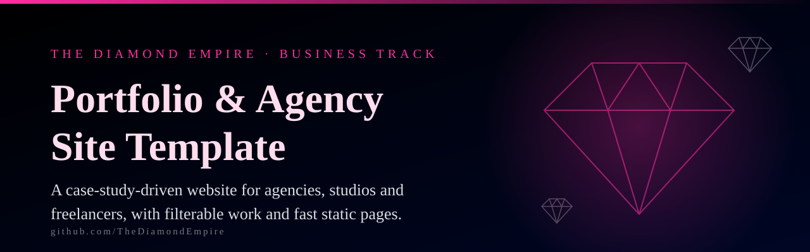

# Portfolio & Agency Site Template: Client Case Study

> A site that shows the work well, loads fast and is easy to keep up to date.

> **Status of this document.** This is a reference case study: it sets out the business problem, the solution and the value model. The results table is intentionally blank and is filled in only from measured data (a pilot or a real engagement). No outcome figures are claimed here.

## Snapshot

|  |  |
|---|---|
| **Who it is for** | Agencies, design studios and freelancers who win work by showing it. |
| **Solution** | A case-study-driven website for agencies, studios and freelancers, with filterable work and fast static pages. |
| **Track** | Business · Advanced |
| **Delivered by** | The Diamond Empire |

## The challenge

Generic portfolio sites bury the work, load slowly and are hard to keep current, so good projects never reach prospects.

## The solution

A Next.js template for agencies, studios and freelancers whose work is the product: a filterable work grid, long-form case-study pages, services, team and contact, all statically generated, accessible and easy to rebrand.

What the client gets in practice:

- Work grid with category filtering that works without JavaScript and is enhanced with it
- Case-study pages from MDX with image galleries, results sections and next-project navigation
- Services, team and contact pages; an RSS feed for news posts
- Pictures that always state their width and height to avoid layout shift, with optional smaller variants for responsive loading
- Open Graph images generated at build time for every page

## How it creates value

| Value lever | How the solution delivers it | How we measure it |
|---|---|---|
| Inquiry conversion | Clear case studies and fast pages | Contact submissions per 1,000 visits |
| Time to add a project | A new case study is one file | Minutes to publish a project |
| Visibility | Static pages, structured metadata and RSS | Organic impressions |
| Maintenance cost | No server and no database to run | Hours per month on upkeep |

## How an engagement runs

| Phase | What happens |
|---|---|
| Plan | Projects, categories and brand |
| Build | Case studies and pages |
| Polish | Imagery, motion and checks |
| Launch | Deploy and handoff |

## What the client receives

- Rebranded site on the client’s domain
- Existing projects migrated into case studies
- Hosting and deployment
- Short editing guide

## Results

Baseline measurements are taken **before** the solution goes live, and the same measures are taken after, so every change in the table is attributable and honest.

| Measure | How measured | Baseline | After | Change |
|---|---|---|---|---|
| Inquiry conversion | Contact submissions per 1,000 visits | — | — | — |
| Time to add a project | Minutes to publish a project | — | — | — |
| Visibility | Organic impressions | — | — | — |
| Maintenance cost | Hours per month on upkeep | — | — | — |

> **To fill in:** replace each — with measured values and add the measurement window and sample size beneath the table.

## How quality and risk are managed

- Automated accessibility scan (axe-core) of every page type, with violations counted and reported (it finds only part of the problems that affect people, stated plainly)
- Front matter validated when the site is built; broken links, missing pictures and missing picture sizes fail the tests
- Layout-shift and page-weight budgets enforced in tests
- Clean install, type check, lint, unit tests and static build pass from a fresh checkout

## Is this a fit?

Best suited to: agencies, design studios and freelancers who win work by showing it.

## Talk to me

Want this adapted to your business? Get in touch via **[thedempire.shop](https://thedempire.shop/)**.

---

[README](../README.md) · [Client case study](case-study.md)
